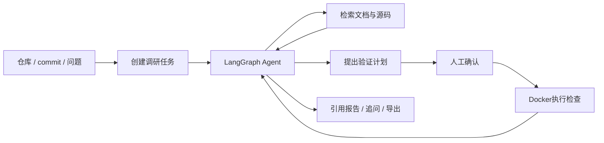

# RepoLens

开源项目调研与复现 Agent。输入 GitHub 仓库、commit 和问题，Agent 检索文档与源码、定位相关实现，生成带文件和行号引用的报告，并按需提出验证计划。

适用于开源库选型、陌生项目接手、依赖环境梳理和源码实现核对。

## 核心功能

- **固定版本调研**：归档仓库快照，关联 commit、文件摘要和源码引用。
- **检索与工具调用**：FTS、Elasticsearch BM25 / 向量 / 混合检索，配合清单检查、文件读取和 Python AST 符号定位。
- **多轮调研**：保留同版本上下文与证据摘要，支持继续追问和工作区偏好。
- **审批与验证**：展示执行计划，确认后运行 Python 语法、unittest 或 pytest 检查，保存输出和结果。
- **任务恢复**：持久化检查点、租约续约、显式重试、取消与事件流续接。
- **资料与报告**：ZIP 分片上传、断点续传、摘要校验、S3 归档与报告导出。
- **MCP 与评测**：通过 MCP 提供检索工具，使用离线用例记录工具选择、参数、检索、耗时和 Token 消耗。

## 工作流程



Java 服务管理身份、工作区、任务状态与消息投递；Python 服务运行 Agent、检索和验证流程。事务 Outbox 与 RocketMQ 处理任务唤醒，PostgreSQL 保存图检查点，快照与检索缓存复用已处理内容。

## 技术栈

| 层次 | 技术 |
|---|---|
| 任务后台 | Java 17、Spring Boot、MyBatis-Plus、MySQL、Redis、RocketMQ |
| Agent | Python 3.12、FastAPI、LangGraph、DeepSeek、MCP |
| 检索与存储 | Elasticsearch、Embedding、PostgreSQL、SQLite、RustFS / S3 |
| 页面与工程 | Vue 3、Docker Compose、JUnit、pytest、Ruff、k6 |

## 快速开始

准备 PowerShell 7、JDK 17+、Maven、Node.js、Python 3.12、uv 和 Docker Desktop。

```powershell
./scripts/init-local.ps1
./scripts/verify.ps1
./scripts/executor-build.ps1
./scripts/apps-build.ps1
```

在 `repo-agent/.env` 配置模型服务：

```dotenv
DEEPSEEK_API_KEY=你的模型密钥
LIVE_MODEL_ENABLED=true
MODEL_BUDGET_CNY=300
```

启动服务：

```powershell
./scripts/apps-start.ps1
```

访问 **http://127.0.0.1:8094/**。本地账号为 `alice`、`bob`、`operator`；登录密码位于 `infra/.env` 的 `REPOLENS_DEMO_PASSWORD`。

停止服务：

```powershell
./scripts/apps-stop.ps1
```

## 使用示例

```text
仓库：https://github.com/pallets/click
commit：934813e4d421071a1b3db3973c02fe2721359a6e
问题：这个版本要求的最低 Python 版本和构建后端是什么？请引用源码。
```

任务页显示工具调用过程、源码引用和报告。可以继续追问，也可以提交 Python 验证需求，查看计划后批准或拒绝执行。

## 项目结构

```text
repo-control/            Java任务后台、页面与测试
repo-agent/src/          Agent、工具、检索与执行逻辑
repo-agent/tests/        Python测试
repo-agent/evaluation/   离线评测用例与评分工具
repo-agent/executor/     验证运行镜像
infra/                  中间件与部署配置
scripts/                构建、运行与验收入口
docs/                   部署、验证与组件说明
```

## 文档

- [部署与配置](docs/INTEGRATION.md)
- [验证记录](docs/VERIFICATION.md)
- [第三方组件与许可](docs/THIRD_PARTY_NOTICES.md)
